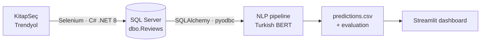

# 📚 Turkish Book Review Sentiment Analysis

[Türkçe](README.md)

An **end-to-end data pipeline** that scrapes book reviews from Turkish e-commerce sites (KitapSeç, Trendyol), stores them in SQL Server, classifies their sentiment with a Turkish BERT model, and presents the results in an interactive dashboard.

Computer Engineering senior (capstone) project.



## Features

- **Data collection (C#):** Selenium navigates category pages and extracts book title, ISBN, user rating and review text. Handles pagination, new tabs, cookie banners and graceful `Ctrl+C` cancellation (`CancellationToken`).
- **De-duplication:** a persisted SHA-256 hash column on the review text plus a unique index prevents the same review from being stored twice, enforced at the database level.
- **Sentiment classification (Python):** batched inference with the pretrained [`savasy/bert-base-turkish-sentiment-cased`](https://huggingface.co/savasy/bert-base-turkish-sentiment-cased) model from Hugging Face; uses the GPU automatically when available.
- **Evaluation:** compares predictions with labels derived from user ratings (1–2 ★ negative, 4–5 ★ positive) and writes a classification report and confusion matrix.
- **Dashboard (Streamlit + Plotly):** per-book positive-share ranking, label distribution, book detail view, confidence-based review filtering, and one-click recomputation from the UI.
- **Two data sources:** `DATA_MODE=csv` (quick try with sample data) or `DATA_MODE=sql` (real database).

## Tech stack

| Layer | Technology |
| --- | --- |
| Scraping | C#, .NET 8, Selenium WebDriver |
| Database | Microsoft SQL Server, T-SQL |
| NLP | Python, PyTorch, Hugging Face Transformers, BERT |
| Evaluation | scikit-learn, pandas |
| Visualization | Streamlit, Plotly |

## Project structure

```
├── scraper/            C# Selenium scrapers (KitapSeç, Trendyol)
├── sql/schema.sql      Database and table schema
├── nlp/src/
│   ├── infer.py        BERT inference + evaluation
│   └── db.py           Reads reviews from SQL Server
├── dashboard/          Streamlit dashboard (app.py + pages/)
├── data/
│   ├── raw/            Sample (synthetic) reviews
│   └── processed/      Predictions and evaluation outputs
└── scripts/mock_data.py  Synthetic sample-data generator
```

## Setup and usage

### 1. Quick try (no database needed)

```bash
pip install -r requirements.txt
cd nlp
python -m src.infer          # data/raw/sample_reviews.csv → data/processed/predictions.csv
cd ..
streamlit run dashboard/app.py
```

The model (~440 MB) is downloaded from Hugging Face on the first run.

### 2. With real data (SQL Server)

1. Run `sql/schema.sql` on SQL Server.
2. Copy `.env.example` to `config/.env` and fill in the connection settings.
3. Run the scraper (Google Chrome required):
   ```bash
   cd scraper
   dotnet run -- both        # both | kitapsec | trendyol
   ```
   By default it connects to a local SQL Server with Windows authentication; set the `BOOKSENT_DB_CONN` environment variable to use another server.
4. Generate predictions from the database:
   ```bash
   cd nlp
   DATA_MODE=sql python -m src.infer       # Windows PowerShell: $env:DATA_MODE="sql"
   ```
5. Open the dashboard: `streamlit run dashboard/app.py`

## Known limitations and next steps

- **The model is binary.** It separates positive from negative and has no neutral class; in the sample data every 3-star (neutral) review was labeled negative. Metrics are therefore computed without neutral reviews. Next step: fine-tune a three-class model on the collected data.
- **Rating ≠ sentiment.** A user's star rating is a noisy proxy for the sentiment of the text (e.g. a 4-star review that is mostly critical), so the evaluation is approximate.
- **Sample data is synthetic.** `data/raw/sample_reviews.csv` is 300 rows generated from 9 template sentences; the accuracy on it does not reflect real model performance. The real scraped reviews are not included, in line with the sites' terms of use.
- **Selectors are brittle.** The scrapers depend on page structure (XPath/CSS) and need updating when the sites change their layout.

## Credits

Developed by **Dilara Şevval Dağ** ([@dilaraadagg](https://github.com/dilaraadagg)) as a senior capstone project: BERT sentiment classification, evaluation, the Streamlit dashboard, and updates to the scrapers.

The first version of the scrapers that collect reviews into SQL Server, and of the database schema, was built together with **Kağan Deniz** ([@Kaandnz](https://github.com/Kaandnz)) during an internship.
