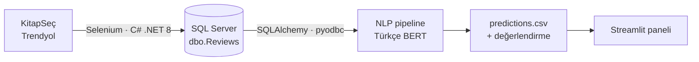

# 📚 Türkçe Kitap Yorumları Duygu Analizi

[English](README.en.md)

Türk e-ticaret sitelerinden (KitapSeç, Trendyol) kitap yorumlarını toplayan, SQL Server'da saklayan, Türkçe BERT modeliyle duygu sınıflandırması yapan ve sonuçları etkileşimli bir panelde gösteren **uçtan uca veri hattı**.

Bilgisayar Mühendisliği bitirme projesi.



## Özellikler

- **Veri toplama (C#):** Selenium ile kategori sayfalarında gezinip kitap adı, ISBN, kullanıcı puanı ve yorum metnini çeker. Sayfalama, yeni sekmeler, çerez onayı ve `Ctrl+C` ile güvenli iptal (`CancellationToken`) desteklenir.
- **Tekrarsız kayıt:** Yorum metninin SHA-256 özetini tutan hesaplanmış sütun ve benzersiz indeks, aynı yorumun ikinci kez kaydedilmesini veritabanı seviyesinde engeller.
- **Duygu sınıflandırma (Python):** Hugging Face'teki önceden eğitilmiş [`savasy/bert-base-turkish-sentiment-cased`](https://huggingface.co/savasy/bert-base-turkish-sentiment-cased) modeliyle toplu (batch) çıkarım; GPU varsa otomatik kullanılır.
- **Değerlendirme:** Kullanıcı puanından türetilen etiketlerle (1–2 ★ negatif, 4–5 ★ pozitif) karşılaştırma; sınıflandırma raporu ve karışıklık matrisi üretilir.
- **Panel (Streamlit + Plotly):** Kitap bazında pozitif oran sıralaması, etiket dağılımı, kitap detayı, güven skoruna göre yorum filtreleme ve panelden tek tıkla yeniden hesaplama.
- **İki veri kaynağı:** `DATA_MODE=csv` (örnek veriyle hızlı deneme) veya `DATA_MODE=sql` (gerçek veritabanı).

## Teknolojiler

| Katman | Teknoloji |
| --- | --- |
| Veri toplama | C#, .NET 8, Selenium WebDriver |
| Veritabanı | Microsoft SQL Server, T-SQL |
| NLP | Python, PyTorch, Hugging Face Transformers, BERT |
| Değerlendirme | scikit-learn, pandas |
| Görselleştirme | Streamlit, Plotly |

## Proje yapısı

```
├── scraper/            C# Selenium scraper'ları (KitapSeç, Trendyol)
├── sql/schema.sql      Veritabanı ve tablo şeması
├── nlp/src/
│   ├── infer.py        BERT ile tahmin + değerlendirme
│   └── db.py           SQL Server'dan yorum okuma
├── dashboard/          Streamlit paneli (app.py + pages/)
├── data/
│   ├── raw/            Örnek (sentetik) yorumlar
│   └── processed/      Tahminler ve değerlendirme çıktıları
└── scripts/mock_data.py  Sentetik örnek veri üretici
```

## Kurulum ve çalıştırma

### 1. Hızlı deneme (veritabanı gerekmez)

```bash
pip install -r requirements.txt
cd nlp
python -m src.infer          # data/raw/sample_reviews.csv → data/processed/predictions.csv
cd ..
streamlit run dashboard/app.py
```

İlk çalıştırmada model (~440 MB) Hugging Face'ten otomatik indirilir.

### 2. Gerçek veriyle (SQL Server)

1. `sql/schema.sql` dosyasını SQL Server'da çalıştırın.
2. `.env.example` dosyasını `config/.env` olarak kopyalayıp bağlantı bilgilerini girin.
3. Scraper'ı çalıştırın (Google Chrome kurulu olmalı):
   ```bash
   cd scraper
   dotnet run -- both        # both | kitapsec | trendyol
   ```
   Varsayılan bağlantı yerel SQL Server'a Windows kimliğiyle yapılır; farklı bir sunucu için `BOOKSENT_DB_CONN` ortam değişkenini tanımlayın.
4. Tahminleri veritabanından üretin:
   ```bash
   cd nlp
   DATA_MODE=sql python -m src.infer       # Windows PowerShell: $env:DATA_MODE="sql"
   ```
5. Paneli açın: `streamlit run dashboard/app.py`

## Bilinen sınırlamalar ve geliştirme fikirleri

- **Model yalnızca iki sınıflı.** Kullanılan model pozitif/negatif ayrımı yapar; nötr sınıfı yoktur. Örnek veride 3 yıldızlı (nötr) yorumların tamamı negatif olarak etiketlendi. Bu nedenle metrikler nötr yorumlar hariç hesaplanır. Sonraki adım: toplanan veriyle üç sınıflı bir modele ince ayar (fine-tuning) yapmak.
- **Puan ≠ duygu.** Kullanıcı puanı, yorum metninin duygusunun gürültülü bir göstergesidir (ör. 4 yıldız verip eleştiren yorumlar). Değerlendirme bu yüzden yaklaşık bir ölçüdür.
- **Örnek veri sentetiktir.** `data/raw/sample_reviews.csv`, 9 şablon cümleden üretilmiş 300 satırlık deneme verisidir; buradaki doğruluk değeri modelin gerçek başarısını yansıtmaz. Toplanan gerçek yorumlar, sitelerin kullanım koşulları gereği repoya eklenmemiştir.
- **Seçiciler kırılgan.** Scraper'lar sayfa yapısına (XPath/CSS) bağlıdır; site tasarımı değiştiğinde güncellenmeleri gerekir.

## Katkılar

Proje, **Dilara Şevval Dağ** ([@dilaraadagg](https://github.com/dilaraadagg)) tarafından bitirme projesi olarak geliştirilmiştir: BERT ile duygu sınıflandırması, değerlendirme, Streamlit paneli ve scraper'ların güncellenmesi.

Yorumları toplayıp SQL Server'a aktaran scraper'ların ve veritabanı şemasının ilk sürümü, staj sırasında **Kağan Deniz** ([@Kaandnz](https://github.com/Kaandnz)) ile birlikte geliştirilmiştir.
